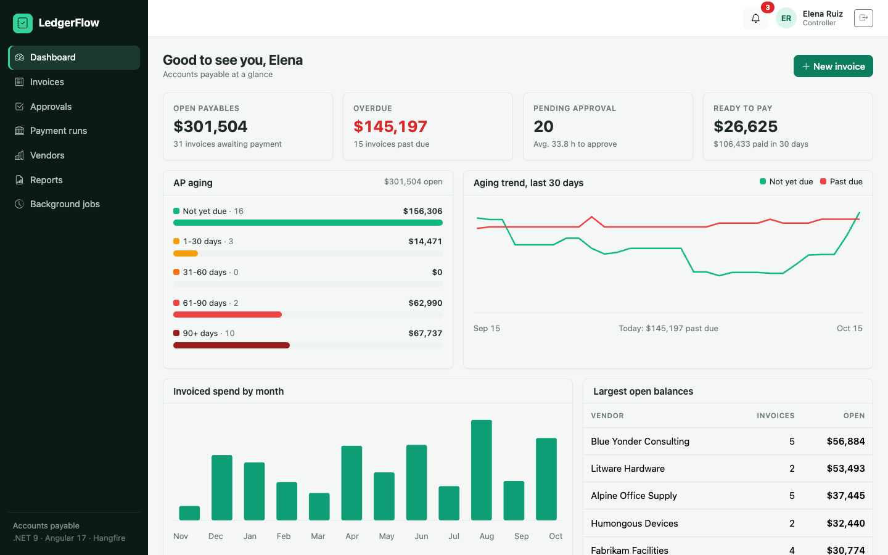
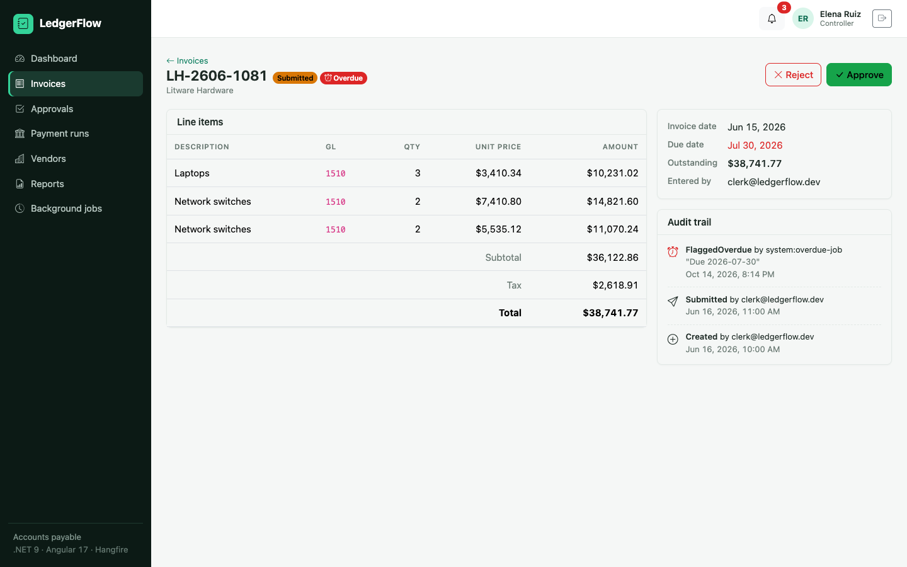
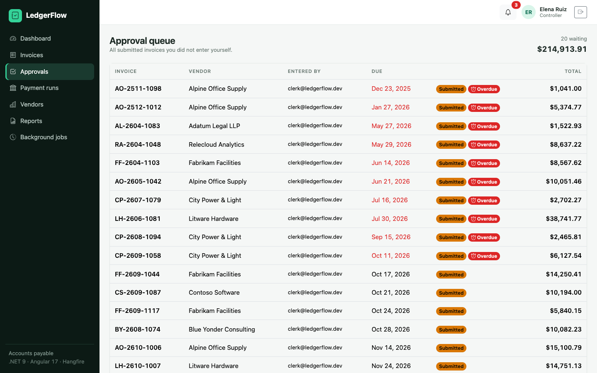
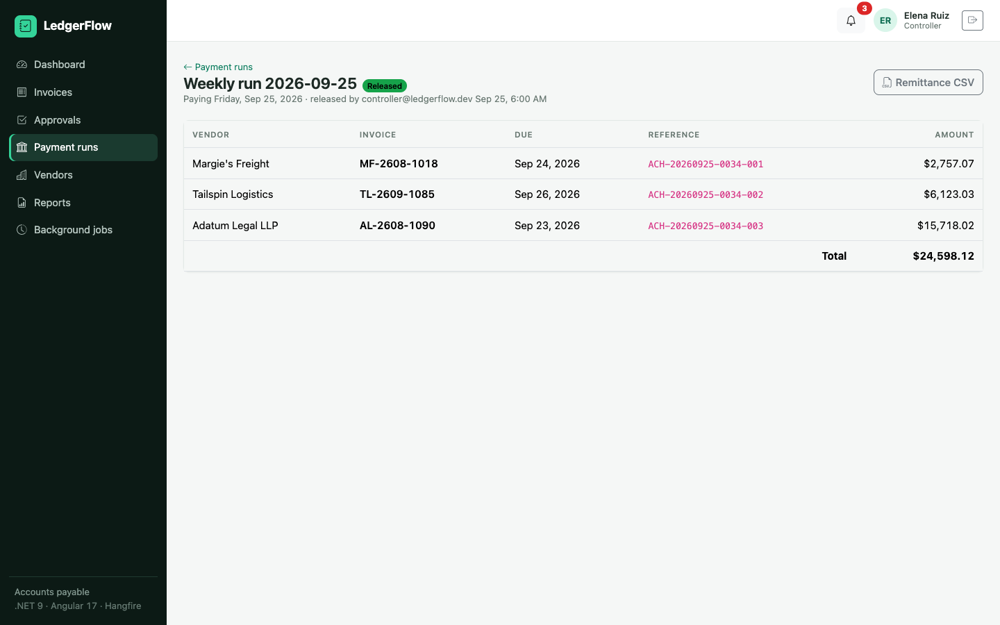
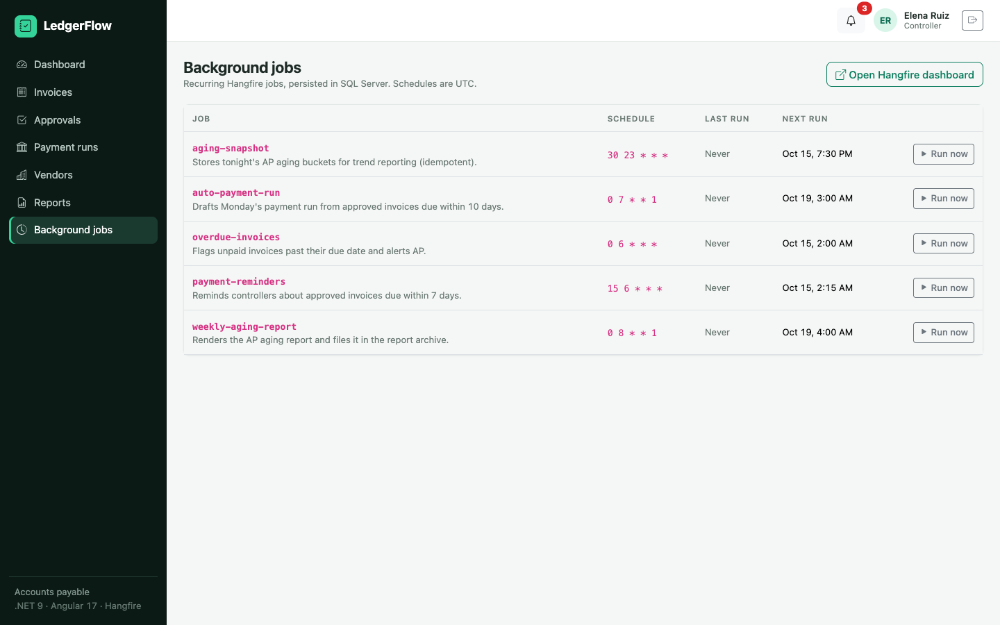
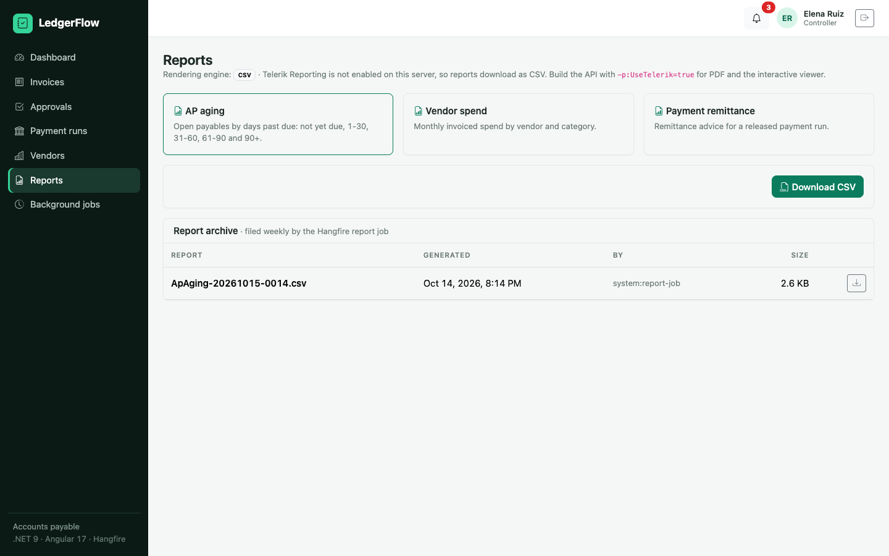
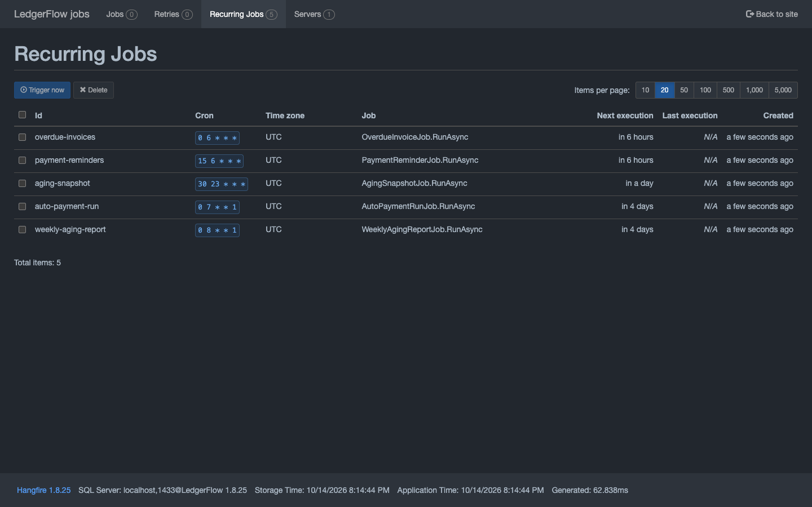
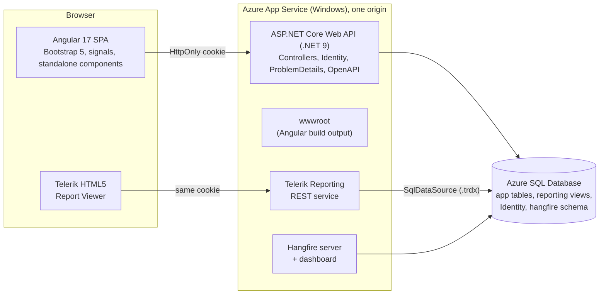

# LedgerFlow

Accounts payable platform: vendor invoices go through a role-based approval workflow, get batched into payment runs, and feed aging and spend reporting. Background jobs flag overdue invoices, remind controllers, snapshot aging every night, draft weekly payment runs, and archive reports.

Built with C#, ASP.NET Core Web API on .NET 9, EF Core, Azure SQL Server, Hangfire, Telerik Reporting, Angular 17, TypeScript and Bootstrap. It ships as a Visual Studio 2022 solution and deploys through Azure DevOps.



| Invoice approval with audit trail | Approval queue |
| --- | --- |
|  |  |
| **Payment run with ACH references** | **Background jobs (Hangfire)** |
|  |  |
| **Reports and archive** | **Hangfire dashboard** |
|  |  |

## What it does

- **Roles.** Clerks enter invoices, Approvers approve up to $10,000, and Controllers approve anything, release payment runs and manage jobs.
- **Business rules in the domain model.**
  - Segregation of duties: whoever entered an invoice cannot approve or reject it.
  - Approval limits.
  - Rejections require a reason.
  - Only approved invoices can be scheduled.
  - Only controllers release payments.
  - Every state change is written to an audit trail.
- **Payment runs.** Approved invoices are batched; release marks them paid with sequential ACH references (`ACH-20260925-0034-001`).
- **Optimistic concurrency.** SQL Server `rowversion` on vendors and invoices; stale edits return `409 concurrency_conflict`.
- **Dashboard.** Open payables, overdue amount, pending approvals, AP aging buckets, a 30-day aging trend (from nightly snapshots), monthly spend and the largest open balances.
- **Reporting.** AP aging, vendor spend and payment remittance as Telerik report definitions (`.trdx`), viewed in the Telerik HTML5 viewer or rendered to PDF; CSV for every report; a weekly archive written by a Hangfire job.
- **Notifications.** In-app feed per role and per user (for example, "your invoice was rejected: Missing PO"), filled by background jobs.

## Architecture



The Angular app is served from the API's `wwwroot`, so the SPA, the Telerik viewer and the Hangfire dashboard share one origin and one HttpOnly, SameSite=Strict auth cookie. That means no CORS, no tokens in browser storage, and no separate static-site hosting.

## Project structure

The repository has two halves, each self-contained: `backend/` opens in Visual Studio 2022 as a normal .NET solution, and `frontend/` is a standard Angular CLI workspace.

```
ledgerflow/
├── backend/                         .NET 9 solution (open LedgerFlow.sln)
│   ├── LedgerFlow.sln
│   ├── Directory.Build.props        shared compiler settings, analyzers, Telerik build switch
│   ├── Directory.Packages.props     central NuGet versions
│   ├── global.json                  pins the .NET 9 SDK
│   ├── nuget.config                 nuget.org + Telerik feed (credentials from env vars)
│   ├── src/
│   │   ├── LedgerFlow.Domain/          entities and business rules, no dependencies
│   │   │   ├── Common/                 Entity base, DomainException, Roles, ApprovalPolicy
│   │   │   ├── Invoices/  Payments/  Vendors/  Operations/
│   │   ├── LedgerFlow.Application/     use cases, one folder per feature
│   │   │   ├── Abstractions/           ILedgerFlowDb, ICurrentUser, IJobScheduler, IReportRenderer
│   │   │   ├── Invoices/               InvoiceService, DTOs, SaveInvoiceValidator
│   │   │   ├── Payments/  Vendors/  Dashboard/  Notifications/  Reporting/
│   │   │   └── Jobs/                   one class per Hangfire job + JobCatalog
│   │   ├── LedgerFlow.Infrastructure/  EF Core, Identity, Hangfire, Telerik
│   │   │   ├── Persistence/            DbContext, seeding
│   │   │   │   ├── Configurations/     one IEntityTypeConfiguration per entity
│   │   │   │   ├── Interceptors/       audit stamps
│   │   │   │   └── Migrations/
│   │   │   ├── Identity/  Jobs/  Reporting/
│   │   └── LedgerFlow.Api/             ASP.NET Core host
│   │       ├── Controllers/            one controller per resource
│   │       ├── Hosting/                error handling, current user, Hangfire auth
│   │       ├── Reports/                Telerik .trdx report definitions
│   │       └── Program.cs
│   └── tests/
│       ├── LedgerFlow.UnitTests/         domain rules and validators (xUnit)
│       └── LedgerFlow.IntegrationTests/  full HTTP tests against SQL Server (WebApplicationFactory)
├── frontend/                        Angular 17 workspace (builds into backend/src/LedgerFlow.Api/wwwroot)
│   └── src/app/
│       ├── core/                    app-wide singletons, imported as @core/...
│       │   ├── api/                 one typed service per API resource (InvoicesApi, VendorsApi, ...)
│       │   ├── auth/                AuthService, guards, HTTP interceptor
│       │   ├── http/                problem-details error helpers
│       │   ├── models/              TypeScript contracts mirroring the API DTOs
│       │   └── toast/
│       ├── shared/                  reusable building blocks, imported as @shared/...
│       │   ├── ui/                  status-badge/, pager/, loading/
│       │   └── utils/
│       ├── layout/shell/            sidebar, top bar, notifications
│       ├── features/                one folder per business area, all lazy loaded
│       │   ├── auth/login/
│       │   ├── dashboard/
│       │   ├── invoices/            invoice-list/, invoice-detail/, invoice-form/, invoices.routes.ts
│       │   ├── approvals/approval-queue/
│       │   ├── payment-runs/        payment-run-list/, payment-run-new/, payment-run-detail/, payment-runs.routes.ts
│       │   ├── vendors/vendor-list/
│       │   ├── reports/             report-center/, report-viewer/ (Telerik)
│       │   └── jobs/job-list/
│       ├── app.routes.ts  app.config.ts  app.component.ts
├── infra/                           Bicep for Azure SQL + App Service
├── docs/screenshots/
├── docker-compose.yml               local SQL Server
└── azure-pipelines.yml              Azure DevOps CI/CD
```

Conventions:

- **Backend:** one type per file, file-scoped namespaces that match folders, and unused `using` directives treated as build errors (`backend/.editorconfig`).
- **Frontend:**
  - Every component lives in its own folder with separate `.ts`, `.html` and `.scss` files.
  - Features import shared code through the `@core`, `@shared`, `@features` and `@layout` path aliases, never through `../../`.
  - Unused locals and parameters fail the build.

## Where each technology is used

| Technology | Where |
| --- | --- |
| C# / .NET 9 | All of `backend/`; `backend/global.json` pins the 9.0 SDK. Nullable, analyzers and warnings-as-errors are on. |
| ASP.NET Core Web API | `backend/src/LedgerFlow.Api`: attribute-routed controllers, Identity API endpoints, rate-limited login, RFC 9457 problem details, OpenAPI + Scalar UI, health checks. |
| EF Core | `backend/src/LedgerFlow.Infrastructure/Persistence`: migrations, `rowversion` concurrency, keyless view entities, an audit interceptor, execution strategy plus transactions, `ExecuteUpdate`/`ExecuteDelete`. |
| Azure SQL Server | Production database (`infra/main.bicep`, free offer by default). Locally, SQL Server 2022 in Docker. Reporting views are created by a migration. |
| Hangfire | `Application/Jobs/` (five recurring jobs plus a fire-and-forget decision notification), `Infrastructure/Jobs/HangfireJobScheduler.cs`, SQL Server storage, and a dashboard at `/hangfire` restricted to Controllers. |
| Telerik Reporting | `Api/Reports/*.trdx`, `Api/Controllers/TelerikReportsController.cs` (REST service), `Infrastructure/Reporting/TelerikReportRenderer.cs` (PDF export), `frontend/src/app/features/reports/report-viewer/` (Angular viewer). |
| Angular 17 + TypeScript | `frontend/`: standalone components, signals, `input()`/`output()`, built-in control flow, `@defer`, functional guards and interceptor, typed reactive forms. |
| Bootstrap | Bootstrap 5.3 SCSS with a custom theme (`frontend/src/styles.scss`) plus Bootstrap Icons. |
| VS 2022 | `backend/LedgerFlow.sln` opens directly; the API is the startup project. |
| Azure DevOps | `azure-pipelines.yml`: build, .NET and Angular tests with a SQL Server service container, coverage, publish, Bicep provisioning, zip deploy, smoke test. |

## Running locally

**Prerequisites:**

- .NET 9 SDK.
- Node 20 (`frontend/.nvmrc`).
- Docker, for SQL Server.
- Optional: Visual Studio 2022 17.12 or later on Windows.

1. **Start SQL Server**

   ```bash
   docker compose up -d sql
   ```

   On Apple Silicon, SQL Server needs x86 emulation: enable Rosetta in Docker Desktop, or use `colima start --vm-type vz --vz-rosetta`.

2. **Run the API.** It migrates the database, seeds demo data and starts Hangfire.

   ```bash
   dotnet run --project backend/src/LedgerFlow.Api
   ```

   The Development connection string in `appsettings.Development.json` matches the compose file. To use another server, run `dotnet user-secrets set ConnectionStrings:LedgerFlow "<connection string>" --project backend/src/LedgerFlow.Api`.

3. **Run the Angular app**

   ```bash
   cd frontend
   npm ci
   npm start        # http://localhost:4200, proxies /api and /hangfire to the API
   ```

   Or run `npx ng build`, which writes into the API's `wwwroot`; then everything is served from http://localhost:5076.

4. **Sign in** with a demo account. The password is `LedgerFlow!2026` for all three.

   | Account | Role |
   | --- | --- |
   | clerk@ledgerflow.dev | Clerk: enters and submits invoices, drafts payment runs |
   | approver@ledgerflow.dev | Approver: approves up to $10,000 |
   | controller@ledgerflow.dev | Controller: approves anything, releases payments, manages jobs |

- API reference: http://localhost:5076/scalar
- Jobs dashboard: http://localhost:5076/hangfire (sign in as the controller first)

### Visual Studio 2022

Open `backend/LedgerFlow.sln`, set `LedgerFlow.Api` as the startup project and press F5. Test Explorer picks up both xUnit projects. For the Angular app, run `npm start` in `frontend/`, or use VS's JavaScript project support if you prefer.

## Tests

```bash
dotnet test backend/LedgerFlow.sln     # 32 unit tests + 19 integration tests
cd frontend && npm run test:ci         # 16 Angular tests in headless Chrome
```

The integration tests boot the real API with `WebApplicationFactory` against a throwaway database (`LedgerFlow_Tests_<guid>`), which is migrated, seeded and dropped afterwards. They cover:

- The full invoice-to-payment workflow.
- Approval limits and segregation of duties.
- Validation errors and duplicate detection.
- Concurrency conflicts.
- Role checks.
- Hangfire job idempotency.
- Reports, health and security headers.

Point them at another server with `LEDGERFLOW_TEST_SQL`.

## Telerik Reporting (trial)

Telerik Reporting is commercial. The 30-day trial is free, and the packages come from Telerik's private NuGet feed, so the solution builds in two modes:

| Build | Reporting |
| --- | --- |
| `dotnet build` (default) | CSV for every report and in the weekly archive. The Telerik code is compiled out with `#if TELERIK`. |
| `dotnet build -p:UseTelerik=true` | Telerik REST service, interactive viewer in the Angular app, PDF export, PDF archive. |

To switch Telerik on:

1. Start a Telerik Reporting trial at telerik.com and generate a NuGet API key in your Telerik account.
2. Export the feed credentials. `backend/nuget.config` reads them from the environment:

   ```bash
   export TELERIK_NUGET_USER=api-key
   export TELERIK_NUGET_KEY=<your key>
   ```

3. Install your Telerik license key (`telerik-license.txt` from your account, or the `TELERIK_LICENSE` environment variable).
4. Set `TelerikVersion` in `backend/Directory.Packages.props` to the version on the feed. Keep `TelerikPackageSuffix` as `.Trial` for the trial, or set it empty for a licensed install.
5. Build and run with `-p:UseTelerik=true`. The Reports page then shows the viewer and PDF links.

> [!NOTE]
> The Telerik code paths are written against the documented APIs, but they have not been compiled here, because that needs the trial feed. Expect to adjust package versions on the first `-p:UseTelerik=true` build.

The Angular viewer is pinned to `@progress/telerik-angular-report-viewer` 28.25.1111, the last release that supports Angular 17. It is loaded with `@defer`, so it costs nothing until the Reports page opens. The PDF renderer is native on Windows, which is one reason the App Service plan is Windows. On Linux or macOS, Telerik needs its Skia graphics package.

## Deploying to Azure with Azure DevOps

The pipeline (`azure-pipelines.yml`) has two stages.

1. **Build and test**, on every push and PR to `main`:
   - Restore and build with warnings as errors.
   - Start a SQL Server service container and run the unit and integration tests, with results and coverage.
   - Run the Angular tests and build Angular into `wwwroot`.
   - `dotnet publish` and zip the package.
2. **Deploy**, on `main` only, gated by the `ledgerflow-dev` environment:
   - `az deployment group create` with `infra/main.bicep`.
   - Zip deploy to the Windows App Service.
   - Poll `/health` until the app is up.

One-time setup in Azure DevOps:

1. Create an Azure Resource Manager service connection named `ledgerflow-azure`.
2. Create a variable group `ledgerflow-secrets` with `SqlAdminPassword`, plus `TelerikNugetKey` and `TelerikLicenseKey` if you build with Telerik. Then set the pipeline variable `UseTelerik` to `true`.
3. Create an environment `ledgerflow-dev`. Optionally add an approval check.

New Azure DevOps organizations have to request the free Microsoft-hosted parallel job through Microsoft's form, which takes a couple of days. A self-hosted agent works immediately.

Deploying the Bicep by hand:

```bash
az group create -n rg-ledgerflow-dev -l eastus2
LEDGERFLOW_SQL_PASSWORD='<strong password>' \
  az deployment group create -g rg-ledgerflow-dev -f infra/main.bicep -p infra/main.dev.bicepparam
```

The app connects to Azure SQL with the SQL admin login from a secure parameter. A natural next step is a managed identity: the web app already has a system-assigned identity, so you would set an Entra admin on the server and run `CREATE USER [<app name>] FROM EXTERNAL PROVIDER`.

## Costs and hosting

Approximate monthly prices (USD, East US, list price) as of late 2026; check the Azure pricing calculator before you deploy.

| Piece | Where it runs | Cost |
| --- | --- | --- |
| Web app (API + Angular + Hangfire + Telerik service) | Azure App Service, Windows | **F1:** free, but no Always On, so recurring jobs only fire while the site is in use. **B1:** about $55/month, with Always On. |
| Database | Azure SQL Database, serverless, free offer | Free: 100,000 vCore-seconds and 32 GB of storage per database per month (the number of free databases per subscription is capped). It auto-pauses when the allowance runs out. |
| Hangfire | Inside the web app, storage in the same database | Free (open source, LGPL). |
| CI/CD | Azure DevOps Services | Free for up to 5 users, with one Microsoft-hosted parallel job (1,800 minutes/month). |
| Telerik Reporting | NuGet package + Angular viewer | 30-day free trial, then a paid per-developer license. |
| Visual Studio 2022 | Your Windows machine | Community edition is free for individuals and small teams. |
| .NET 9, Angular, Bootstrap, EF Core | | Free and open source. |

With Azure for Students ($100 credit, no card), F1 plus the free SQL offer costs nothing. B1 uses about half the credit per month.

## Support lifecycle

- .NET 9 is a standard-term support release, supported until November 2026. Moving to .NET 10 (LTS) means changing `global.json` and the package versions.
- Angular 17 is past end of support. It is used here because the stack requires it; the code already uses the signal-based APIs that carry forward to newer versions.

## API overview

| Endpoint | Purpose |
| --- | --- |
| `POST /api/auth/login?useCookies=true` | Sign in (cookie for the SPA; omit `useCookies` for a bearer token) |
| `GET /api/auth/me` | Current user and roles |
| `GET/POST/PUT /api/vendors` | Vendor master data, activate and deactivate |
| `GET/POST/PUT /api/invoices`, `POST /api/invoices/{id}/submit,approve,reject` | Invoice workflow |
| `GET /api/invoices/approval-queue` | Invoices waiting for the caller's decision |
| `GET/POST /api/payment-runs`, `POST /api/payment-runs/{id}/release,cancel` | Payment runs |
| `GET /api/dashboard` | KPIs, aging, trends |
| `GET /api/notifications` | Notification feed |
| `GET /api/jobs`, `POST /api/jobs/{id}/trigger` | Recurring jobs (Controller) |
| `GET /api/reports/{name}.{csv,pdf}`, `GET /api/reports/archive` | Reports and archive |
| `/api/telerik-reports/*` | Telerik REST service for the viewer (Telerik builds) |
| `GET /health` | Health check, including SQL |

Errors are returned as `application/problem+json` with a machine-readable `code` (for example `approval_limit_exceeded`, `segregation_of_duties`, `concurrency_conflict` or `validation_failed`).
